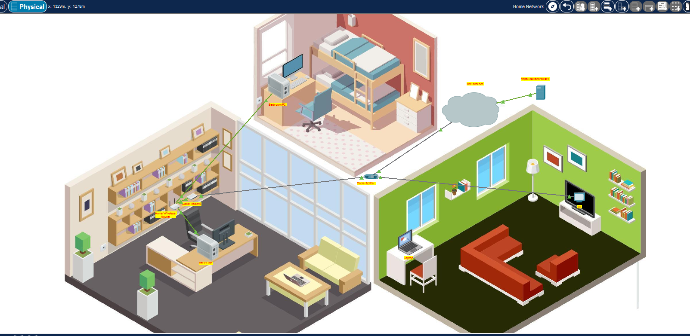

# Lab 01 · Rede doméstica com roteador sem fio

> Montagem e configuração de uma rede residencial no Cisco Packet Tracer: cabeamento coaxial e Ethernet, roteador Wi-Fi com DHCP e WPA2, e testes de conectividade até a "Internet".

**Origem:** atividade do curso de conceitos básicos de redes da Cisco Networking Academy (módulo 4.5). A documentação e as explicações abaixo foram escritas por mim.
**Ferramenta:** Cisco Packet Tracer
**Quer ver o que a atividade pedia?** Leia o [enunciado resumido](enunciado-da-atividade.md).

---

## Resumo rápido

| | |
|:---|:---|
| **Objetivo** | Levar a internet de uma operadora de TV a cabo para uma casa, com 2 PCs cabeados, 1 notebook via Wi-Fi e uma TV |
| **O que eu fiz** | Conectei os dispositivos, configurei o roteador sem fio e testei o acesso de cada equipamento |
| **Conceitos praticados** | Cabo coaxial e Ethernet, DHCP, gateway padrão, WLAN (SSID), WPA2, boas práticas de senha |
| **Resultado** | Os 2 PCs e o notebook acessaram o servidor de testes, e a TV recebeu o sinal de vídeo |

## Topologia

<!-- Se quiser, adicione também o print da visão Logical do Packet Tracer:

-->

---

## O que eu fiz

1. **Conectei os dispositivos.** O cabo coaxial da operadora passa por um splitter que separa internet e TV. A internet vai para o cable modem, que se liga ao roteador por cabo Ethernet. Os dois PCs foram ligados ao roteador por cabo de rede.
2. **Configurei o roteador.** Acessei a interface web pelo navegador, limitei o DHCP a 10 usuários e troquei a senha de administrador padrão.
3. **Criei a rede Wi-Fi.** Ativei o rádio de 2,4 GHz, troquei o nome da rede (SSID) e protegi com WPA2 Personal.
4. **Testei a conectividade.** Conectei o notebook ao Wi-Fi e abri o servidor de testes nos três equipamentos.

> As senhas usadas no laboratório não estão publicadas aqui de propósito. Em um equipamento real, a senha padrão deve ser trocada logo na instalação, porque ela é conhecida publicamente.

### Resultado dos testes

| Teste | Resultado |
|:---|:---|
| Laptop conectado ao Wi-Fi `MyHome` | ✅ Conectou ao access point |
| Laptop acessa `skillsforall.srv` | ✅ Página carregou |
| Office PC acessa `skillsforall.srv` | ✅ Página carregou |
| Bedroom PC recebe IP por DHCP e acessa `skillsforall.srv` | ✅ Página carregou |
| TV recebe o sinal de vídeo | ✅ Imagem exibida |

<!-- Adicione prints dos testes, por exemplo:

-->

<b>Detalhes: conexões e portas</b>

 

| Conexão | Tipo de cabo | Portas |
|:---|:---|:---|
| Splitter → Cable Modem | Coaxial | Coaxial1 → Port 0 |
| Splitter → TV | Coaxial | Coaxial2 → Port 0 |
| Cable Modem → Roteador | Ethernet (straight-through) | Port 1 → porta Internet |
| Office PC → Roteador | Ethernet (straight-through) | FastEthernet0 → GigabitEthernet 1 |
| Bedroom PC → Roteador | Ethernet (straight-through) | FastEthernet0 → GigabitEthernet 2 |

<b>Detalhes: endereçamento IP</b>

 

Os PCs e o notebook receberam o endereço automaticamente por DHCP.

| Dispositivo | Conexão | Endereço IP | Máscara | Gateway padrão |
|:---|:---|:---|:---|:---|
| Roteador | - | [PREENCHER] | [PREENCHER] | - |
| Office PC | Cabo | [PREENCHER] | [PREENCHER] | [PREENCHER] |
| Bedroom PC | Cabo | [PREENCHER] | [PREENCHER] | [PREENCHER] |
| Laptop | Wi-Fi | [PREENCHER] | [PREENCHER] | [PREENCHER] |

---

## O que aprendi

- Como a internet por cabo chega até os equipamentos, e por que o splitter separa o sinal de internet do de vídeo.
- Que o roteador doméstico reúne várias funções em um só equipamento: roteador, switch com portas para cabo e ponto de acesso Wi-Fi.
- Como o **DHCP** entrega IP, máscara e gateway automaticamente, e o papel do **gateway padrão** para chegar a outras redes.
- Por que a segurança do Wi-Fi e a troca de senhas padrão importam, principalmente em áreas com muitas redes por perto.

## Problemas encontrados

Não tive problemas técnicos na configuração da rede. Os erros que apareceram no verificador da atividade foram detalhes de digitação, como uma senha escrita diferente do que o enunciado pedia. Corrigi e rodei o verificador de novo.

---

Lab feito como parte do meu estudo de redes. Veja os outros laboratórios em [network-labs](../).
